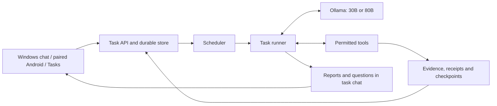

# Nethra harness: current implementation

Inspected 9 November 2026. This describes Nethra's persistent Windows task engine and the chat, model, tools and Android connections around it. Source inspection was read-only; no tasks, settings, models or applications were changed for this audit. The installed Windows archive matches all 97 current source/renderer files. Android build 203 was published from commit `0537eb1a151e8a8c93ff527536c611fb06ae56a4`; some uncommitted Android chat/UI files in this checkout differ from that release.

Live configuration and installed-source evidence: [`artifacts/nethra-harness-snapshot.json`](../artifacts/nethra-harness-snapshot.json). Implementation, live acceptance and limitations are distinguished below.

## 1. What the harness is

Nethra is an Electron/Node.js host on Windows, using Ollama for local model inference. The harness owns task state, scheduling, execution authority, tools, evidence and reporting. The model chooses actions within the capabilities supplied to that task. Android is a paired client for these objectives; the phone does not run their scheduler or hold the 80B weights.

One persistent task can span many model calls and scheduled work passes. Continuation comes from saved structured state. Model weights and hidden reasoning do not store its durable progress.

There are three distinct work systems in the repository:

- **Nethra objectives:** the background research/drafting/monitoring system described here.
- **Foreman / Work Activity:** a separate scoped coding executor and project store, which Nethra can propose work to.
- **Android tool plans:** `ChatManager.activePlan` / `PlanCoordinator`, an on-device plan/approval mechanism with its own capabilities. These are not Nethra objectives.

## 2. Where the code is

Paths in this table are relative to the repository root.

| Responsibility | Primary code | Useful entry point |
|---|---|---|
| Construct the host and connect its services | [`apps/windows/src/main.js`](../apps/windows/src/main.js) | Composition at lines 240–272; reporting at 411; IPC at 542 |
| Persistent tasks, transactions, leases, approvals, actions and jobs | [`nethra-store.js`](../apps/windows/src/nethra-store.js) | `NethraStore`, `create`, `claim`, `control`, `chatTurn`, `configure`, `remove` |
| Due dates, priorities, budgets, continuation and recovery | [`nethra-scheduler.js`](../apps/windows/src/nethra-scheduler.js) | `NethraScheduler.run`, `prepareUpcoming` |
| Prompt, model/tool loop and completion checks | [`nethra-runner.js`](../apps/windows/src/nethra-runner.js) | `systemPrompt`, `completionError`, `NethraRunner._execute` |
| Task tool schemas, path checks and execution | [`nethra-tools.js`](../apps/windows/src/nethra-tools.js) | `NethraTools.definitions`, `validate`, `execute`, `checkedPath` |
| Permitted/executable work and owner questions | [`nethra-task-contract.js`](../apps/windows/src/nethra-task-contract.js) | `taskContract`, `taskWork`, `ownerQuestion` |
| Compact state carried between passes/models | [`nethra-checkpoint.js`](../apps/windows/src/nethra-checkpoint.js) | `checkpointAfterTool`, `seedForWake` |
| Independent inference and measured model jobs | [`nethra-model-inference.js`](../apps/windows/src/nethra-model-inference.js) | `runModelJob`, `inferenceRequirement`, `statistics` |
| Task-specific model compatibility | [`nethra-models.js`](../apps/windows/src/nethra-models.js) | `PROFILES`, `profileFor` |
| Host RPC and task controls | [`nethra-api.js`](../apps/windows/src/nethra-api.js) | `NethraApi.dispatch` |
| Turn chat into durable tasks | [`owner-work-instruction.js`](../apps/windows/src/owner-work-instruction.js), [`nethra-chat.js`](../apps/windows/src/nethra-chat.js), [`nethra-objectives.js`](../apps/windows/src/nethra-objectives.js) | Router, deterministic task commands, shared objective adapter |
| Existing-task follow-ups and chat steering | [`nethra-conversation.js`](../apps/windows/src/nethra-conversation.js), [`nethra-task-turn.js`](../apps/windows/src/nethra-task-turn.js) | `handleTaskFollowup`, `handleTaskTurn` |
| Host-recorded progress and owner reports | [`nethra-progress.js`](../apps/windows/src/nethra-progress.js), [`nethra-conversation-report.js`](../apps/windows/src/nethra-conversation-report.js) | `progressView`, `postQuestions`, `postMilestones`, `postProgress`, `postOutcome` |
| Changed sources, check-ins and initiative | [`nethra-attention.js`](../apps/windows/src/nethra-attention.js) | `observe`, `reconcileCheckIns`, `reconcileInitiative` |
| Ollama requests and shared inference queue | [`local-agent-runtime.js`](../apps/windows/src/local-agent-runtime.js) | `InferenceCoordinator` is inside this file; `LocalAgentRuntime` |
| Ordinary chat's smaller tool catalogue | [`local-agent-tools.js`](../apps/windows/src/local-agent-tools.js) | `LocalAgentToolRegistry` |
| Context compaction and warmup | [`model-context.js`](../apps/windows/src/model-context.js), [`model-warmer.js`](../apps/windows/src/model-warmer.js) | `fitContext`, `ModelWarmer` |
| Public research and retained citations | [`web-research.js`](../apps/windows/src/web-research.js), [`research-coordinator.js`](../apps/windows/src/research-coordinator.js) | `WebResearchClient`, `ResearchCoordinator` |
| Calendar and inbox source adapters | [`calendar-source.js`](../apps/windows/src/calendar-source.js), [`gmail-source.js`](../apps/windows/src/gmail-source.js), [`google-source.js`](../apps/windows/src/google-source.js) | OAuth, polling, cached records and attention |
| Phone checks | [`device-commands.js`](../apps/windows/src/device-commands.js) | `DeviceCommandStore`, signed single-use commands |
| Self-improvement and reviewed coding proposals | [`nethra-code-work.js`](../apps/windows/src/nethra-code-work.js), [`nethra-work-status.js`](../apps/windows/src/nethra-work-status.js), [`foreman.js`](../apps/windows/src/foreman.js), [`foreman-executor.js`](../apps/windows/src/foreman-executor.js) | Proposal → reviewed draft → owner-started candidate → verified patch |
| Advisors and performance experiments | [`advisor-limits.js`](../apps/windows/src/advisor-limits.js), [`codex-client.js`](../apps/windows/src/codex-client.js), [`claude-client.js`](../apps/windows/src/claude-client.js), [`nethra-performance.js`](../apps/windows/src/nethra-performance.js), [`nethra-experiments.js`](../apps/windows/src/nethra-experiments.js) | Read-only advice, quota reserve, recorded measurements and before/after evaluation |
| Per-wake orientation | [`nethra-brief.js`](../apps/windows/src/nethra-brief.js) | Host facts, recent commits and the Windows section of `docs/CODEBASE_MAP.md` |
| Windows Tasks/settings UI | [`apps/windows/renderer/nethra.js`](../apps/windows/renderer/nethra.js) | Creation, detail, approvals, controls and policy settings |
| Windows chat UI and IPC boundary | [`renderer/parity.js`](../apps/windows/renderer/parity.js), [`src/preload.js`](../apps/windows/src/preload.js) | Streaming chat and context-isolated bridge |
| Startup and background host | [`nethra-startup.js`](../apps/windows/src/nethra-startup.js), [`nethra-startup.ps1`](../apps/windows/src/nethra-startup.ps1) | Per-user scheduled task and `--agent-host` |

Android sources are under `apps/android/src/main/java/com/splinch/junction/`:

- [`data/sync/lan/NethraClient.kt`](../apps/android/src/main/java/com/splinch/junction/data/sync/lan/NethraClient.kt): task RPC, paired LAN first, encrypted relay fallback, durable mutation request IDs.
- [`data/sync/lan/LanTransport.kt`](../apps/android/src/main/java/com/splinch/junction/data/sync/lan/LanTransport.kt): pinned peer identity, challenge authentication and correlated requests.
- [`feature/projects/NethraPanel.kt`](../apps/android/src/main/java/com/splinch/junction/feature/projects/NethraPanel.kt): Tasks UI and controls.
- [`feature/projects/ObjectiveStatusMonitor.kt`](../apps/android/src/main/java/com/splinch/junction/feature/projects/ObjectiveStatusMonitor.kt): cached/stale task status.
- [`feature/chat/ui/ChatScreen.kt`](../apps/android/src/main/java/com/splinch/junction/feature/chat/ui/ChatScreen.kt): task-linked chat presentation.
- [`assistant/provider/LanFirstJunctionPcProvider.kt`](../apps/android/src/main/java/com/splinch/junction/assistant/provider/LanFirstJunctionPcProvider.kt): normal local chat sent to the paired Windows runtime.
- [`assistant/runtime/ChatManager.kt`](../apps/android/src/main/java/com/splinch/junction/assistant/runtime/ChatManager.kt): ordinary provider/context/conversation facade; also contains the separate Android plan integration.

For the released Android chat/UI behavior, inspect those files at commit `0537eb1a151e8a8c93ff527536c611fb06ae56a4`. Build 203 removes the extra recorded-actions polling/card from chat and hides old per-cycle progress messages, while retaining saved messages and task records. Those cleanup changes are not all reflected in the current uncommitted Android UI files.

## 3. Task state and lifecycle

A task records its ID, goal, success criteria, selected model, mode, persistence/continuous flags, approved read roots, workspace, source subscriptions, plan, completed/pending steps, questions, owner inputs, evidence, checkpoint, dependencies, approvals, priority, autonomy, check-in policy, wake reason/time, usage, errors, timestamps and revision.

States are `CREATED`, `PLANNING`, `ACTIVE`, `SLEEPING`, `WAITING_FOR_USER`, `BLOCKED`, `PAUSED`, `FAILED`, `CANCELLED`, `COMPLETED`. Terminal states are completed/cancelled/failed. `SLEEPING` is often a healthy saved wait for the next check.

The three continuation choices are independent:

- `persistent`: survive across passes/host restarts, rather than pause after a pass.
- `continuous`: promptly continue productive work, rather than use normal pacing.
- `mode`: `FINITE` closes when achieved; `ONGOING` records verified milestones and returns to monitoring.

The API's basic creation defaults are persistent=true, continuous=false, finite, 30B. Chat's objective creation adapter normally sets continuous=true. Either UI can set the task model and pacing explicitly.

Execution proceeds as follows:

1. A chat instruction or Tasks action creates the durable record and links a conversation.
2. The scheduler finds eligible due work, checks dependencies/budgets and claims the singleton execution lease.
3. The runner reconstructs the current contract, plan, latest owner input, saved outputs, evidence, questions, jobs and checkpoint.
4. It calls the task's selected local model with tool definitions. The model requests structured actions.
5. Host code validates each action, executes permitted capabilities and saves real results/receipts before proceeding.
6. New owner input is checked before inference results/tool calls are used; stale action choices are discarded.
7. The task finishes, waits for a specific missing requirement, records a future wake, or yields with a saved checkpoint.
8. Reporting writes grounded questions, milestones and outcomes into the linked owner conversation.

The scheduler polls about once a second. It prioritizes 1 before 5 and ages waiting tasks to reduce starvation. Productive continuous work normally resumes after **20 seconds**. Ordinary wakes are clamped to **5 minutes–7 days**. Ongoing monitoring after a milestone defaults to weekly/daily/six-hourly for Quiet/Balanced/Active. Active/Balanced initiative can revisit verified unfinished work after 15/60 minutes. Direction check-ins can be daily, weekly, milestone-based or manual; a progress check-in alone cannot block the task.

Every pass has a **20-minute wall limit**, at most **24 model turns** and **20 tool actions**. Reaching a work budget saves a continuation. Daily inference budgets, when enabled, count model inference rather than time spent awaiting research or queued behind the owner. The code defaults are one hour globally and twenty minutes per objective per day; the owner's current saved daily budgets are both unlimited (`null`).

Repeated failures use backoff and ask for direction after five consecutive attempts. Separate no-progress checks stop repeated unproductive short cycles; unchanged inputs can skip inference entirely. Routine unchanged source monitoring can reschedule without loading a model.

The single execution lease is renewed while working. Revisions, lease tokens and request IDs fence stale workers and duplicate mutations. An interrupted reserved write is held for review instead of being blindly replayed. Normal checkpointed shutdown releases the lease. A hard crash can leave a lease until expiry; scheduler leases are 21 minutes, after which expired execution recovery can reclaim persistent work.

## 4. What the task model can request

The catalogue has **22 named tools**, filtered by task permissions and available adapters. Ordinary chat has a separate smaller catalogue: search, start/list/get/message an objective, and owner-authorized coding delegation.

| Tools | Actual capability and boundary |
|---|---|
| `update_plan` | Save up to 30 distinct steps; retain completed work; reject completion of blocked steps. |
| `web_search` | Public research with retrieved evidence. Queries are bounded and checked against owner/public provenance; private file contents do not automatically become outbound search terms. This is a guarded research service rather than a general browser. |
| `list_directory` | List up to 100 entries in approved roots; sensitive names and symlinks are omitted. |
| `read_file` | Read approved UTF-8 text files up to 64,000 bytes, in small pages. SHA256/offset cursors detect changed sources and survive model handoff. Binary/NUL files, credential paths, traversal and scope escapes are rejected. There is no PDF/DOCX parsing tool in this set. |
| `write_draft` | Create UTF-8 files inside this task's workspace, up to 24,000 content characters per call. Revising this task's verified output creates a content-hash revision and keeps the original. Other overwrites need exact approval. |
| `request_approval` | Request the implemented protected action: replacement of an existing workspace draft. It cannot authorize an absent shell/send/deploy capability. |
| `run_model` | Queue separate local inference prompts or measured jobs, save every result, and resume partial jobs. See section 5. |
| `delegate_task` | Up to two sequential research children using the same task model. Depth one; each has up to two turns and two read-only calls. Only search/file-read/list tools are exposed. Parent reviews the returned observations. |
| `request_input` | Save an optional or essential owner question, optionally blocking one named step. Independent executable steps continue. At most eight questions remain open. |
| `reply_to_owner` | Post a bounded answer into the latest linked owner conversation, deduplicated for that request. It does not itself finish work or approve another action. |
| `schedule_wake` | Save a future check. Scheduler policy determines its effective bounds and continuation pacing. |
| `finish_objective` | Explicit completion after host evidence checks. In ongoing mode this becomes a milestone and monitoring wake. |
| `calendar_event` | Read a cached, freshly authorized watched primary-calendar event. The adapter polls yesterday through fourteen days ahead, up to 250 events. |
| `gmail_message` | Read watched inbox message headers/labels/IDs, including From/Subject/Date. The adapter uses Gmail metadata access; it does not read message bodies or attachments or send mail. |
| `phone_check`, `phone_result` | Request and later collect signed read-only phone status, smoke-test or bounded log results. Requires pairing/contact; no phone installation is exposed to Nethra. |
| `host_diagnostics` | Inspect available memory, process/context limits and advisor readiness. These are snapshots rather than proof of a speed improvement. |
| `performance_report` | Summarize recorded objective inference and local-chat measurements from the last seven days. |
| `consult_codex`, `consult_claude` | Bounded advice through locally signed-in advisors, when code work is enabled and usage allows. Advice remains labelled advice. |
| `experiment` | Start/list/mark/evaluate/abandon before-and-after performance experiments. |
| `propose_code_work` | Obtain Codex review and create a READY Work Activity draft for owner-started implementation and later review/apply. |

Path enforcement uses canonical approved roots and resolved-path checks, rejecting UNC/device/URL paths, traversal, links and sensitive names. Action keys bind the exact task, tool, path and content. Draft receipts are current only while actual file size/hash still match. The tool validator checks known/required fields, primitive types, enumerations and lengths; it is not a complete JSON Schema implementation, and important numeric tools perform additional explicit range checks.

The task catalogue currently provides no arbitrary shell, browser/desktop-control, arbitrary HTTP/download, external email/message sending, publishing/deploying, purchasing, git push/merge, or general file deletion tool. The Windows app has other explicitly owner-invoked capabilities; those do not automatically become Nethra task tools.

## 5. Models, model handoff and independent inference

Supported task models are currently exactly:

- `qwen3:30b`: default, native thinking enabled, task reasoning budget 1,100 tokens.
- `junction-qwen3-next:80b-q3km`: Qwen3-Next 80B A3B Instruct Q3_K_M, thinking disabled. The local alias uses a corrected chat template. Actual installed parameter count was verified as 79,674,391,296.

Both share the same store, contract, tools, checkpoint and completion pipeline. Task-model changes fence the old execution and preserve saved work. Chat-provider/model choice and a task's saved model are separate settings. New models need an explicit supported profile/runtime integration; the present implementation is not an unrestricted model plug-in loader.

Some host status/warmup code is still centered on the default 30B model. In particular, `nethra.status` identifies its model as `qwen3:30b`; that label alone does not identify the model executing an individual task. Use the task's saved model, recorded model-step events and native inference metadata for that question.

The ordinary task step has a 16,384-token context and a 1,536-token generation limit. Compaction removes old raw tool results and complete old exchanges while retaining system instructions, seed and latest exchange. Latest owner input is refreshed each call; earlier inputs are bounded historical context. Detailed files/results stay on disk and can be reread. Oversized protected context blocks explicitly. The 80B compatibility fallback accepts an entire known-tool invocation printed as JSON text, through the same validation pipeline.

All local calls share the inference coordinator inside `local-agent-runtime.js`. Interactive chat gets priority; fairness grants background work a turn after three interactive jobs. Preemptible background calls can be aborted/requeued twice before becoming nonpreemptible. The slot is held per model call, so file/search waits do not monopolize it. Multiple saved tasks and child workers therefore do not imply parallel 80B inference.

Warmup generates no reply and uses saved retention (currently two hours). It deduplicates loads and applies memory/cooldown guards. Objective prewarm is wired for 30B and deliberately skipped for 80B; an 80B call can still load its model when needed. Model changes can incur a substantial cold-load cost.

`run_model` gives the controller an explicit way to request additional inference:

- Either supported target model, even if different from the controller.
- Prompt up to 4,000 characters, fixed system text up to 1,500, 1–50 identical samples, 16–512 output tokens. Defaults are one sample and 128 output tokens.
- Each worker receives just the fixed system/user pair: no parent history or tools.
- Temperature zero; actual native prompt/output counts and timings are captured.
- At most three samples per call. Each is persisted before advancing; a saved job ID resumes the remaining total.
- Deterministic job identity and immutable request metadata prevent drift/repetition. Late results after pause/lease loss cannot be committed.
- Exact responses and metrics are saved in `model-runs/<jobId>/sample-NNN.json` and cumulative `results-NNN.json`, through normal draft receipts.
- Metrics distinguish generation speed, wall latency, queue delay and total elapsed workflow time.

The host, rather than the model process, queues and executes these requests and wakes the task later.

## 6. Chat, approvals, reporting and Android

Desktop routes explicit task commands, saved-task follow-ups and linked-task messages before ordinary provider inference. Thus a chat-model switch does not erase task controls. Ordinary local chat can also call `start_objective`, `list_objectives`, `get_objective` and `send_objective_message`.

Each task has a linked chat, created if necessary. Messages there become durable direction or answers to saved questions. New input is checked during running work, so an old model response cannot silently override newer steering. Ambiguous task references ask which task. A status request reads host state. A saved answer while paused leaves the pause intact. A generic “continue” does not approve a pending exact action.

Chat supports task creation, list/status, pause/resume, check-now, cancellation, redirection and model naming. In the chat parser, “stop” is a reversible pause; explicit cancel ends the task. The Tasks UI's Stop action uses cancellation, while Delete removes task records/workspace and keeps its conversation. Stopping a streamed chat reply is another distinct operation.

Questions, verified ongoing milestones and completion/blocker/failure outcomes post to the linked chat with stable IDs/cursors. Productive-cycle reporting also exists in the installed Windows host. Settings select All/Important/Off proactive updates, plus quiet hours. Quiet hours defer report delivery without stopping useful task execution; not every suppressed low-priority update is queued for later replay. Task details retain recorded progress, model/actor, evidence and actual output receipts.

Android Tasks uses the same Windows API independently of the chat provider. It can create/configure/control/edit/redirect/delete tasks, switch their model, open their chats, answer questions and review appropriately sized exact approvals. Authorizing PC read roots, enabling code work, source OAuth administration and certain host/startup/advisor settings require Windows.

For **Android free-text task steering**, the visible host route is the paired local PC provider. Android `ChatManager` does not independently route every cloud provider's messages into Nethra. The Tasks panel remains usable independently of the current chat provider. Both supported local models use the paired host path.

Task RPC tries authenticated paired LAN first and encrypted Firebase relay as fallback. It preserves a digest-bound mutation request ID across retries/transports, reducing duplicate actions. A timeout does not prove a mutation failed. LAN pins peer identity and uses a nonce challenge; relay messages use AES-GCM. Ordinary streamed chat avoids falling back after a send might already have reached the host. Cached offline task lists are labelled stale; the phone is not an offline Nethra execution engine.

Ollama's default endpoint is loopback `127.0.0.1:11434`. The currently running Windows app has a loopback listener on 43110 and paired LAN listeners on 43111; the local PC companion uses a separate ephemeral loopback endpoint. These are distinct roles, and Android reaches inference through the paired app rather than a publicly exposed Ollama endpoint.

## 7. Self-improvement and coding

With owner-enabled code work and an approved Junction repository root, a task may inspect host facts/performance/recent commits, ask Codex or Claude for advice, propose changes and track measurable experiments.

Advisors use locally signed-in CLIs and a saved usage reserve (currently 10%). Codex is invoked with a read-only sandbox and isolated configuration; its instructions forbid commands/files/network for this advice path, but the adapter does not explicitly disable every Codex tool. Claude's advice adapter disables tools/settings/MCP and session persistence. Advice cannot count as an applied code change or measured speedup.

The Nethra proposal path requires exact Codex review. `REVISE` creates no draft and is technical feedback to address. A READY result creates a Work Activity draft scoped to `apps/windows`, with fixed `npm test` verification. The owner starts implementation, then reviews/applies the exact verified candidate. Foreman works in an isolated repository snapshot and verifies source/head/diff before applying. Applied changes are staged for the owner to commit; Nethra does not automatically push or publish itself. This is distinct from the separate explicit owner coding instruction path used by ordinary chat.

Experiments compare task inference time, chat response time or chat tokens/sec. Baseline and after groups require at least five observations. Evaluation uses median effect (at least 5%) and a two-sided tie/continuity-corrected Mann–Whitney threshold p<0.05, otherwise reporting no clear change. Real-workload comparisons are described as observational. Code-change evidence needs a verified host-source commit or linked applied Work Activity plus a later host start before after-samples count. Declared settings/other changes are explicitly unverified.

## 8. Where the data lives and what continues

On this PC, the app-data root is `C:/Users/jf358/AppData/Roaming/junction-windows/`:

| Path beneath app data | Contents |
|---|---|
| `nethra/nethra.sqlite` | Authoritative task database, schema 5; tasks, journal events, lease, requests, approvals, actions, model jobs, settings, usage, executions, inference intervals, children, attention, experiments, host starts and advisor readings. SQLite WAL/transactions protect updates. |
| `nethra/workspaces/<task-id>/` | Per-task drafts, revisions and measured model-run files. |
| `nethra/device-commands.sqlite` | Signed device-command queue/results. |
| `nethra/model-profile.json` | Recorded local model/runtime profile. |
| `local/junction-local.json` | Conversations, owner memory facts, usage and synchronization metadata. Separate from the objective database. |
| `research/research-jobs.json` | Bounded research jobs and passage evidence. |
| `foreman/` | Separate coding project/executor state. |
| `sources/` and `identity/` | Source authorization and pairing/account state; sensitive credentials use the host vault/safeStorage path. |
| `logs/startup.log`, `audit/` | Startup recovery and action/audit records. |
| `appearance.json` | Device appearance preferences, independent of tasks. |

The default store caps are 500 total objectives and 100 nonterminal/nonpaused active objectives. Owner memory is a separate bounded fact list, not an automatically indexed document library.

The packaged runtime is `apps/windows/dist/nethra-qwen3-next-q3km-20261106/`, launched through `Nethra.lnk`/`Junction.lnk`. It is a complete Electron directory, not a portable exe by itself. A per-user Windows scheduled task starts `--agent-host` after sign-in and retries/restarts the host on a one-minute schedule. This is an interactive-user task, not a system service that runs before sign-in.

Closing the Android UI does not end Windows objectives. Closing the Windows window retains the host while persistent unfinished objectives exist. Explicit Quit shuts down services orderly. PC power/sleep, Ollama availability, connection/source failures, owner gates and inference limits still affect progress. A host restart reconstructs saved work; it does not preserve an in-flight model's private reasoning.

## 9. What has actually been demonstrated

- [`artifacts/nethra-continuous-chat-acceptance.md`](../artifacts/nethra-continuous-chat-acceptance.md): actual 80B read a local fixture, wrote successive drafts across automatically scheduled passes, asked an essential title question, accepted chat pause/answer/resume/format steering, saved the requested final output and reported completion. Automatic continuations in that fixture needed no new owner message or restart. The chat route was exercised as the shared Android-source handler; this was not a physical phone transport test.
- [`artifacts/nethra-model-inference-acceptance.md`](../artifacts/nethra-model-inference-acceptance.md): actual 79,674,391,296-parameter Q3_K_M 80B chose `run_model`, completed fifty fixed-prompt samples, resumed saved measurements across five controlled deployment restarts, saved receipt-backed results and posted Done to its chat. The timed-call result was 17.023 aggregate tokens/sec and 1,434.92 ms mean wall time on this very short prompt. Whole elapsed job time included controller/debugging/restarts; these figures do not establish arbitrary essay performance or a speed improvement.
- Latest delivered verification: full Windows suite passed, including 452 tests in its final group; Android 223 unit tests and debug build passed; Android build 203 passed emulator install/launch and signed updater publication. See [`artifacts/nethra-wallpapers-acceptance.md`](../artifacts/nethra-wallpapers-acceptance.md).
- This audit freshly matched all 97 installed Windows source/renderer files against the working implementation and read task settings through a read-only database connection.

At the audit snapshot there were ten stored objectives: six completed, three cancelled and one active. The active task was **Self Improvement**, ongoing, persistent, continuous, Active autonomy, using 80B, code proposals enabled and the Junction repository approved as a read root. No Gmail/Calendar source was selected for that task. Persistent startup was enabled, warm-on-startup was Desktop, retention two hours, proactive updates All, quiet hours disabled and both daily inference budgets unlimited. These are observations, not settings changed by the audit.

## 10. Practical limitations

The harness can schedule, call models, act through real tools, save progress, accept steering and report results. Its quality still depends on the model selecting useful steps, the available adapters and the evidence it receives.

Completion checks cover saved plans, essential questions, relevant tool evidence, requested file reads, current write receipts and explicit measured sample counts. Some checks use text/topic heuristics; a valid file hash or citation ID does not establish the quality of an essay or the truth of every claim. Independent child review is currently a parent-review instruction/marker, not a separate formal verification service.

It does not yet provide a general phone Downloads/email-attachment import, searchable personal document database, PDF/DOCX task parser or automatic indexing of all owner files. The task database already exists, but it stores objectives and execution records. Rich document knowledge/retrieval is a separate missing capability.

It has no general remote desktop/browser agent tool, arbitrary shell/network executor or external send/deploy adapter in the Nethra catalogue. Self-improvement uses reviewed proposals and a separate owner-controlled coding executor. Running many tasks shares one inference slot. Model swaps can be slow. Hard-crash recovery may wait for a lease to expire. Android task-chat messages depend on the selected provider reaching the paired PC; cached offline state does not run work.

Useful starting points for further work are the runner, scheduler, store, task contract and tool catalogue. Together they define what task continuity means and what the model can actually execute.
